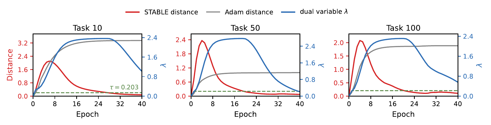

<h1 align="center">
  STABLE: A Continual Learning Optimizer with Adaptive Drift Control
</h1>

<p align="center">
  <a href="https://neurips.cc/virtual/2026/loc/paris/poster/154677"></a>
</p>

<p align="center">
  Xiaoyan Li<sup>1,2</sup>,
  <a href="https://scholar.google.it/citations?user=PnkoFQYAAAAJ&hl=en">Lanpei Li</a><sup>1,3</sup>,
  Massimo Coppola<sup>3</sup>,
  <a href="https://scholar.google.it/citations?user=rQLINtQAAAAJ&hl=en">Vincenzo Lomonaco</a><sup>2</sup>,
  <a href="https://scholar.google.it/citations?user=G-1jrFoAAAAJ&hl=en">Antonio Carta</a><sup>1</sup>
</p>

<p align="center">
  <sup>1</sup>University of Pisa &nbsp;&middot;&nbsp;
  <sup>2</sup>Luiss Guido Carli University &nbsp;&middot;&nbsp;
  <sup>3</sup>ISTI, National Research Council of Italy (CNR)
</p>

Official implementation of **STABLE** (Stabilizing Training Adaptation with Budgeted Lagrangian
Enforcement), accepted at the
[40th Conference on Neural Information Processing Systems (NeurIPS 2026)](https://neurips.cc/Conferences/2026).
This repository contains the optimizer and the code for the vision results of STABLE in Table 1
of the paper.

STABLE is a drop-in replacement for Adam in continual learning. At every task boundary, it
stores the current parameters as an anchor and then solves the next task under a drift budget,
`||theta - theta_anchor||^2 <= tau^2`. The constraint is enforced softly: the gradient of the
Lagrangian, `grad L + 2 * lambda * (theta - theta_anchor)`, is fed to Adam, and the multiplier
`lambda` is adjusted after every step from the measured drift. It rises when the parameters move
beyond the budget, which pulls them back towards the previous solution right after a task
switch, and it decays once they are back inside, which restores plasticity for the rest of the
task. The budget can be calibrated automatically from the first task (`drift_budget_sq: auto`);
the Table 1 configurations fix it to the values listed below.

<p align="center">
  
</p>
<p align="center">
  <em>Drift control with LoRA on ImageNet-R (100 tasks), at Tasks 10, 50 and 100 (Figure 1 of the
  paper). After each task switch, the distance from the anchor (red) rises; once it exceeds the
  budget τ (green, dashed), the multiplier λ (blue) rises and draws the parameters back, and then
  decays. Without drift control, the distance under Adam (gray) settles far above the budget.</em>
</p>

## Repository structure

```text
stable/optim.py          STABLE optimizer, usable in any PyTorch training loop
stable/heads.py          Whitened nearest-class-mean head (W-NCM) used for evaluation
stable/models/           ViT-B/16 with LoRA or prefix prompts, and checkpoint loading
stable/pipelines/        Training loops of the LoRA and prompt pipelines
stable/data.py           Datasets, transforms and class-incremental task streams
stable/engine.py         Training, feature extraction and logging shared by both pipelines
stable/metrics.py        Accuracy matrix, final average accuracy and average forgetting
stable/config.py         Run configuration
stable/train.py          Experiment entry point
configs/table1/          One configuration per Table 1 cell
splits/                  Train/test file lists of ImageNet-R and ImageNet-A-100
scripts/                 Data and checkpoint preparation, Table 1 runner, Slurm example
```

## Installation

STABLE was developed and evaluated with Python 3.12 and the CUDA 12.8 build of PyTorch 2.8 on one
NVIDIA A100 GPU (64 GB) per run. The package versions are pinned in `requirements.txt`.

```bash
git clone https://github.com/atlas-luiss/STABLE.git
cd STABLE
python3.12 -m venv .venv && source .venv/bin/activate
pip install -r requirements.txt
```

Run all commands from the repository root.

## Running experiments

### Data and checkpoint preparation

```bash
python scripts/download_checkpoint.py        # ViT-B/16 ImageNet-21k weights, about 400 MB
python scripts/prepare_data.py cifar100      # about 170 MB
python scripts/prepare_data.py imagenet-r    # downloads imagenet-r.tar, about 2.2 GB
python scripts/prepare_data.py imagenet-a    # downloads imagenet-a.tar, about 0.7 GB
```

If you have already downloaded the official archives, pass them with `--tar`, for example
`python scripts/prepare_data.py imagenet-r --tar /path/to/imagenet-r.tar`. The scripts create the
following files and folders:

```text
checkpoints/vit_base_patch16_224.augreg_in21k.safetensors
data/cifar100/cifar-100-python/
data/imagenet-r/{train,test}/<wnid>/<image>
data/imagenet-a-top100/{train,test}/<wnid>/<image>
```

**Checkpoint.** The weights are timm's `vit_base_patch16_224.augreg_in21k`, the AugReg
ImageNet-21k ViT-B/16, downloaded from the Hugging Face Hub
(SHA-256 `2d31bb5597c720912f8ea5e4f1de73909a6911798d78ae5d1b9d63a955fed049`, checked by the
script). A `.pth` file with the same tensors can be used instead with `--checkpoint`.

**Splits.** ImageNet-R (200 classes) and ImageNet-A are distributed without a train/test split,
so the splits used in the paper are given as file lists:

- `splits/imagenet_r.txt`: a random 80/20 split of ImageNet-R, 24,000 training and 6,000 test
  images;
- `splits/imagenet_a100.txt`: ImageNet-A-100, the 100 ImageNet-A classes with the most images
  (ties broken by descending WordNet ID), each split into 80% training and 20% test images,
  4,839 training and 1,164 test images in total.

`prepare_data.py` extracts exactly these files from the official archives
(`https://people.eecs.berkeley.edu/~hendrycks/imagenet-r.tar` and `.../imagenet-a.tar`). It checks
the SHA-256 of each list and a SHA-256 digest of all extracted images, so the data match those
of the paper. `python scripts/prepare_data.py imagenet-r --verify-only` checks an existing folder.
CIFAR-100 is downloaded with torchvision, which checks the MD5 checksums of the files.

**Task order.** Classes are numbered in the order of their folder names (WordNet IDs), or by the
CIFAR-100 label, and consecutive pairs of classes form the tasks. The class order is the same for
every seed; the seed sets the initialization, the order of the training data and the
augmentation.

### Quick check

A two-task run with one epoch per task checks the setup in a few minutes and writes its results
to `outputs/lora_cifar100/seed42/`:

```bash
python -m stable.train --config configs/table1/lora_cifar100.yaml --set max_tasks=2 epochs=1
```

Any config key can be overridden with `--set key=value`; `--seed`, `--data-dir`, `--checkpoint`
and `--output-dir` are also available as flags.

### Reproducing Table 1

```bash
bash scripts/run_table1.sh lora_imagenet_r       # seeds 40, 41 and 42
bash scripts/run_table1.sh prompts_cifar100 42   # a single seed
bash scripts/run_table1.sh all                   # all six cells, three seeds each
```

`scripts/slurm_example.sbatch` runs a cell as a Slurm job. For each configuration, the table
lists its settings, the final average accuracy A_T and average forgetting F_T (in %) reported in
the paper (mean ± standard deviation over seeds 40, 41 and 42), and the wall-clock time of one run
on one A100 (64 GB) with 8 CPU cores:

| Cell (`configs/table1/`) | Stream | Epochs | Batch size | Budget `tau^2` | A_T (↑) | F_T (↓) | Time per run |
|---|---|---|---|---|---|---|---|
| `lora_imagenet_r` | ImageNet-R, 100 tasks | 40 | 24 | 0.04 | 73.12 ± 0.43 | 10.17 ± 0.06 | ≈ 1.8 h |
| `lora_cifar100` | CIFAR-100, 50 tasks | 20 | 128 | 0.08 | 88.77 ± 0.23 | 7.90 ± 0.24 | ≈ 1.5 h |
| `lora_imagenet_a` | ImageNet-A-100, 50 tasks | 50 | 24 | 0.022834 | 62.34 ± 1.30 | 12.11 ± 0.80 | ≈ 0.6 h |
| `prompts_imagenet_r` | ImageNet-R, 100 tasks | 40 | 128 | 5 | 72.99 ± 0.26 | 7.64 ± 0.36 | ≈ 3 h |
| `prompts_cifar100` | CIFAR-100, 50 tasks | 20 | 24 | 7 | 87.88 ± 0.07 | 4.99 ± 0.19 | ≈ 1.7 h |
| `prompts_imagenet_a` | ImageNet-A-100, 50 tasks | 50 | 24 | 7 | 58.88 ± 0.40 | 14.23 ± 0.50 | ≈ 0.7 h |

With A_{t,s} the accuracy on task s after training on task t, A_T is the mean of A_{T,s} over all
tasks, and F_T is the mean over s < T of max_{s <= t <= T} A_{t,s} - A_{T,s}.

**Run-to-run variation.** The prompt pipeline is deterministic up to floating-point rounding: two
runs with the same seed on the same type of GPU agree to within about 0.1 points. The LoRA pipeline
uses PyTorch's fused attention, whose backward pass is not bitwise deterministic on the GPU, so two
runs with the same seed can differ by about one point on ImageNet-R and CIFAR-100, and by a few
points on ImageNet-A-100, whose test set has only 1,164 images. For example, two runs of seed 42
of `lora_imagenet_a` gave A_T = 61.5 and 59.1.

Compare the mean over the three seeds with the table. For `lora_imagenet_a`, seeds 40, 41 and 42
with this code give A_T = 61.57 ± 0.42 and F_T = 11.46 ± 1.16.

### Outputs

`python -m stable.train` writes to `outputs/<cell>/seed<seed>/`, and `scripts/run_table1.sh` to
`outputs/table1/<cell>/seed<seed>/`; `--output-dir` (or `OUTPUT_DIR` for the script) changes the
root. Each run writes `log.txt`, with the loss, squared drift and `lambda` of every epoch and the
accuracy after every task, and `results.json`, which is updated after every task and contains:

- the configuration of the run;
- the accuracy matrix A_{t,s} of the completed tasks;
- the final average accuracy and average forgetting;
- the squared drift budget, calibrated or fixed;
- the value of `lambda` at the end of each task.

### Pipeline details

Both pipelines freeze the ViT-B/16 backbone, train the adapter (LoRA or prompts) with STABLE and
a linear head over all classes with Adam (cross-entropy loss), and evaluate with W-NCM. The linear
head is only used for training; W-NCM is updated after every task with the features of that
task's training data. The remaining differences come from the two code bases the pipelines are
built on, and are kept to reproduce Table 1:

| | LoRA pipeline | Prompt pipeline |
|---|---|---|
| Trainable module | LoRA, rank 8, alpha 16, on `qkv` and `proj` of every block | key and value prefixes of length 20 in every block |
| Augmentation | random resized crop (scale 0.7–1, CIFAR-100: 0.6–1), flip, color jitter (not on CIFAR-100), ImageNet normalization | random resized crop (scale 0.05–1), flip, no normalization (DualPrompt recipe) |
| Head optimizer | one Adam for the whole stream | a new Adam at every task |
| Gradient clipping | none | total norm 1.0 |
| W-NCM statistics | training images with the test transform | one pass over the augmented training loader |
| Data loader workers | 4 | 10 |

Keep `num_workers` and the batch size of the configs to reproduce the numbers: the data loader
workers seed the augmentation.

## Using STABLE in your own training loop

```python
from stable import STABLE

optimizer = STABLE(
    adapter_parameters,       # parameters shared across tasks, e.g. LoRA or prompts
    lr=5e-4,
    weight_decay=1e-4,
    drift_budget_sq="auto",   # squared budget tau^2, or "auto"
    dual_lr=0.03,
    lambda_init=1.0,
)

for task in stream:
    optimizer.start_task()    # at the beginning of every task, including the first
    for x, y in task:
        loss = criterion(model(x), y)
        optimizer.zero_grad()
        loss.backward()
        optimizer.step()
```

- `start_task()` stores the current parameters as the anchor. During the first task there is no
  drift control; `lambda` is set to `lambda_init` at the start of the second task and then carried
  over from task to task.
- `drift_budget_sq` is the squared budget `tau^2`: the squared L2 distance from the anchor,
  summed over all parameters of a parameter group, is kept below it (each group has its own budget
  and multiplier). For example, the value 0.04 of `lora_imagenet_r` is `tau = 0.2`.
- With `drift_budget_sq="auto"`, the budget is calibrated at the end of the first task from the
  squared norms of the last N updates, N = min(32, max(ceil(0.1 T1), 12)) for T1 steps:
  `tau^2 = (L / 5) * Q75`, where Q75 is the 75th percentile of the sums over rolling windows of
  5 steps (taken on a log scale) and L = min(ceil(1 / sqrt((1 - beta1)(1 - beta2))), 256) = 100
  for Adam's default betas. If the first task has fewer than 12 steps, the budget falls back to
  0.06.
- `dual_lr` is the dual step size `eta`. With squared drift `g` and squared budget `b`, `lambda`
  grows by `eta * (g - b (1 + deadzone))` when `g > b (1 + deadzone)` and is multiplied by
  `(g / (b (1 - deadzone)))^eta`, at least `exp(-10)`, when `g < b (1 - deadzone)`; it stays
  unchanged in between and is capped at `lambda_max` (default 100).
- `violation_memory=True` adds the running mean of `max(g - b, 0)` over the current task to each
  increase, which makes the controller react faster when the drift overshoots the budget
  repeatedly after a task switch.
- `optimizer.drift_stats()` returns the last squared drift, `lambda` and the squared budget of
  each parameter group. Weight decay is decoupled: `theta <- theta (1 - lr * weight_decay)` after
  each Adam step.

### Main hyperparameters

| Key | Value in Table 1 | Meaning |
|---|---|---|
| `lr`, `betas`, `eps`, `weight_decay` | 5e-4, (0.9, 0.999), 1e-8, 1e-4 | Adam settings, shared by STABLE and the head optimizer |
| `drift_budget_sq` | see the table above | squared drift budget `tau^2`, or `auto` |
| `dual_lr` | 0.03 | dual step size `eta` |
| `lambda_init` | 1.0 | multiplier at the start of the second task |
| `deadzone` | 0.05 | relative width of the band around the budget where `lambda` is unchanged |
| `violation_memory` | LoRA on ImageNet-R and ImageNet-A-100 | add the running mean violation to each increase |
| `wncm_shrinkage` | 0.07 | shrinkage of the W-NCM covariance towards its diagonal |
| `epochs`, `batch_size` | see the table above | epochs per task and batch size |

## Citation

```bibtex
@inproceedings{li2026stable,
  title     = {{STABLE}: A Continual Learning Optimizer with Adaptive Drift Control},
  author    = {Li, Xiaoyan and Li, Lanpei and Coppola, Massimo and Lomonaco, Vincenzo and Carta, Antonio},
  booktitle = {Advances in Neural Information Processing Systems},
  year      = {2026}
}
```

## License

The code is released under the MIT License (see `LICENSE`). `stable/models/prefix_vit.py` is
adapted from DualPrompt-PyTorch and PyTorch Image Models, both under the Apache License 2.0; see
`THIRD_PARTY_NOTICES`.
